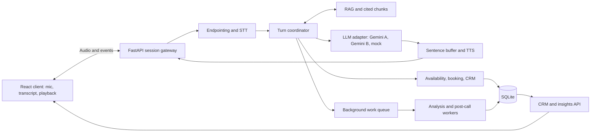
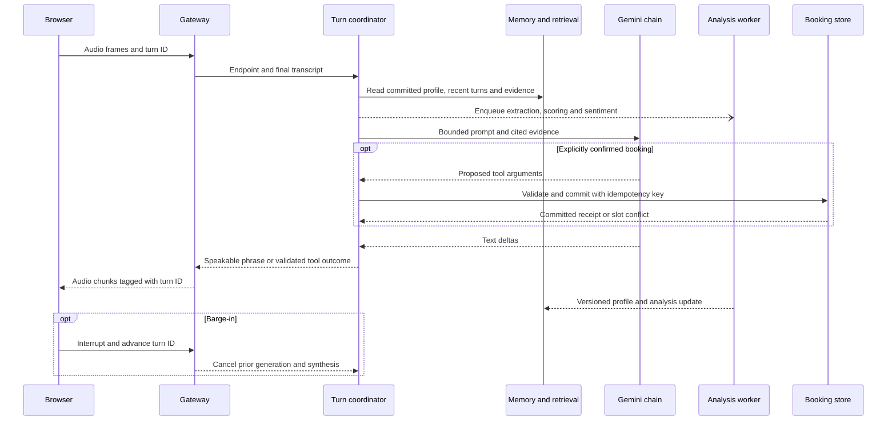
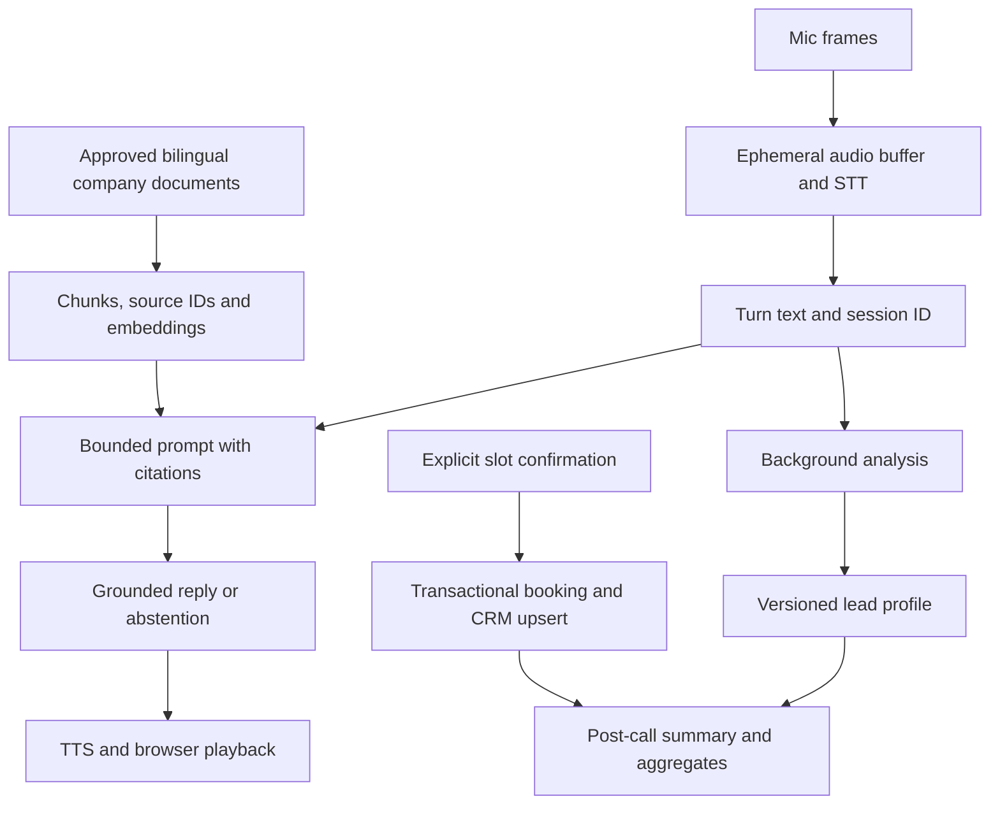

# Architecture

[VERIFIED] The current FastAPI foundation exposes GET /health and validates configuration. [ASSUMED] The diagrams specify the proposed target architecture. Implementation and validation gates are in TASKS.md.

## System

## Per-turn sequence

## Data flow

| Component | Responsibility and technology | Failure handling | Scaling direction |
|---|---|---|---|
| Browser and gateway | React/Vite, FastAPI WebSocket, IDs and bounded buffers | Drop late audio, cancel by turn, expose reconnect status | Stateless gateways with sticky active streams |
| STT and TTS | Compare Gemini and local faster-whisper for STT; Gemini and edge-tts for TTS | Configured mock, browser speech fallback, visible degraded mode | Pool warm workers and bound admission |
| Turn and memory | Read sliding window, rolling summary and structured fields | Proceed using latest committed state; order updates by turn sequence | Redis session state, durable Postgres records |
| Retrieval | Local multilingual embeddings and vector plus lexical search | Below threshold return abstention; retain source version | Independent retrieval workers and managed index |
| LLM | Stream deltas; local caching, token and time budgets | Gemini A → Gemini B → deterministic mock; shared quota cooldown where applicable | Limit by project, model and tenant |
| Booking and CRM | Validate tool args, timezone and consent; SQLite transaction | Unique slot constraint and request replay; webhook outbox | Postgres plus idempotent delivery workers |
| Background analysis | Lead score, sentiment, profile extraction, rolling summary and post-call jobs | Bound queue; retry with deduplication; preserve pending status | Durable queue and independently scaled consumers |
| Telemetry and dashboard | Per-stage timings, aggregates, provider status | Count errors and missing measurements explicitly | Structured metrics and tenant-filtered queries |

OpenAI is optional after a successful bounded credit probe and explicit fallback configuration. With current credit exhausted the standard chain is A → B → mock. Tool proposals and retrieved documents are untrusted inputs. The server owns booking authorization and generates the spoken confirmation from committed state.
