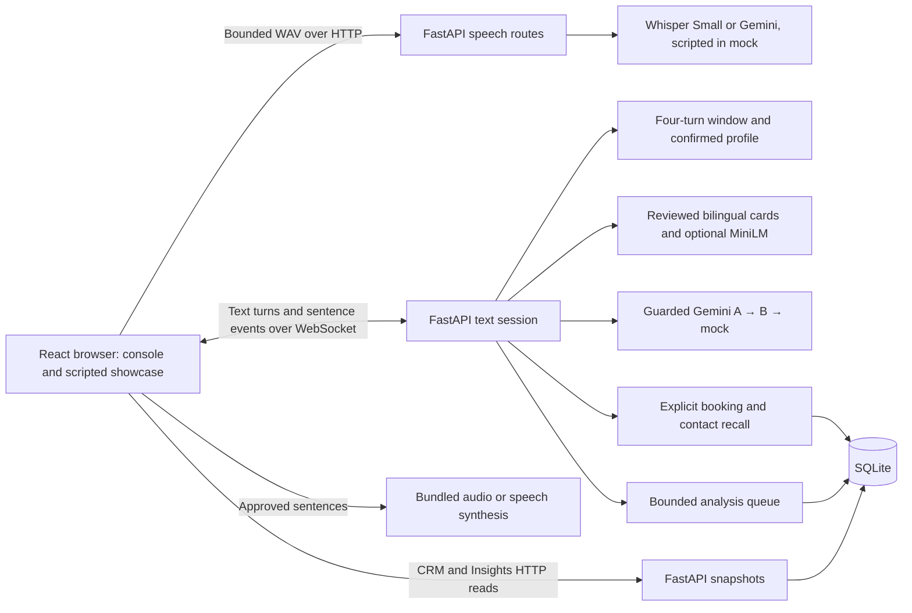
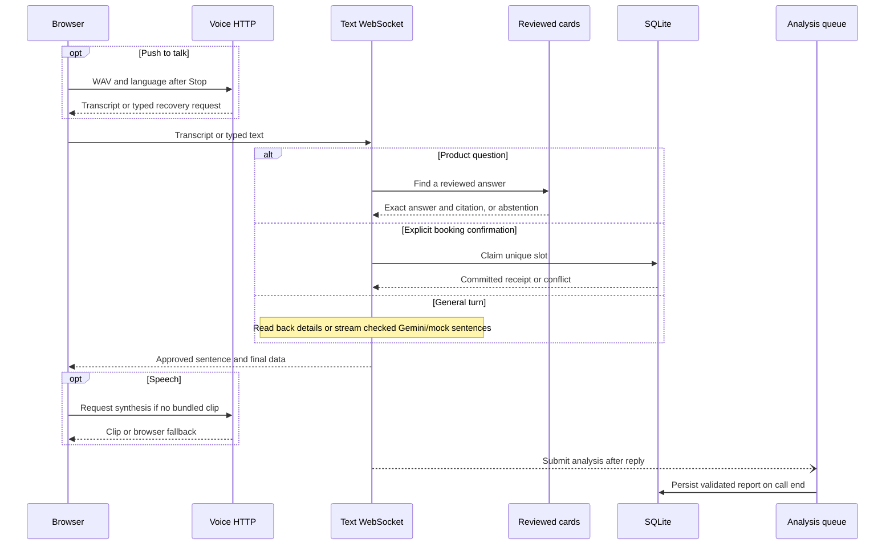
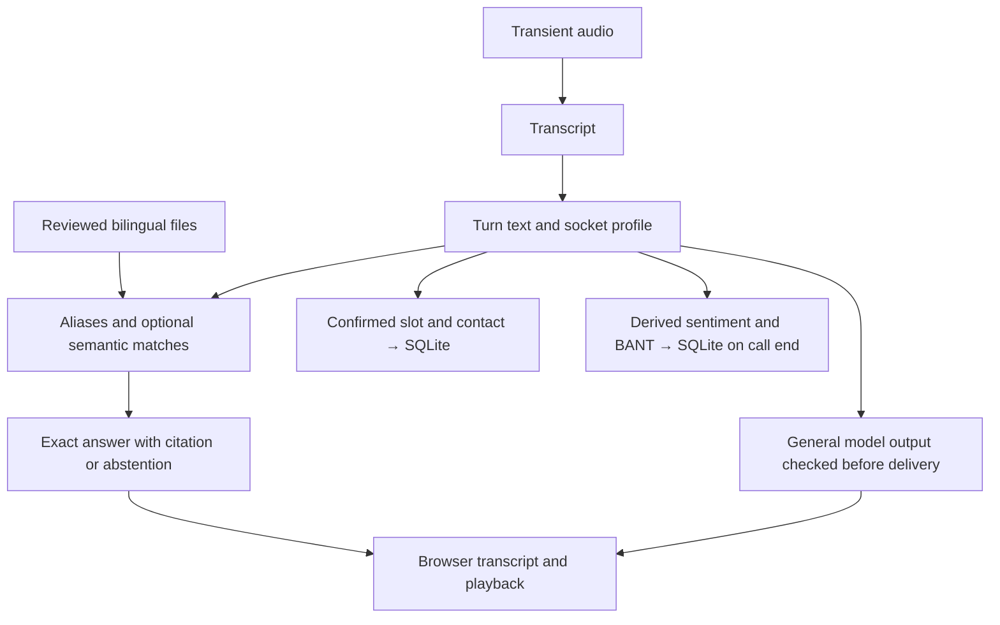

# Architecture

[VERIFIED] These diagrams describe the shipped application. [System SVG](diagrams/system.svg) · [Sequence SVG](diagrams/sequence.svg) · [One-page PDF](diagrams/architecture.pdf)

## System

## Per-turn sequence

## Data flow

| Component | Responsibility and technology | Failure handling | Scaling approach [ASSUMED] |
|---|---|---|---|
| Browser and gateway | React/Vite, FastAPI WebSocket and HTTP audio uploads | Cancel active generation on disconnect. Text stays available if mic fails. | Keep affinity on active sockets and move reconnectable state to Redis. |
| STT and TTS | Push-to-talk WAV, optional local faster-whisper, Gemini, bundled speech, edge-tts and browser playback | Try configured STT backup, type on failure, keep transcript if audio fails. | Warm GPU or managed streaming STT and capacity-limited synthesis. |
| Turn and memory | Four pairs in a socket and readback before committing numbers and dates | Ambiguous details remain pending. Contact recall is a separate SQLite operation. | Redis with expiry and tenant-scoped profile storage. |
| Retrieval and LLM | Digest-reviewed bilingual cards, aliases, optional local similarity. Gemini A → B → mock for general replies. | Weak retrieval abstains. Time and provider budget limits plus checked sentences constrain output. | Managed tenant-filtered index, quota-aware routing and safe caching. |
| Booking and CRM | Explicit confirmation, unique slot constraint, SQLite upsert | Conflict preserves the existing booking. Typed and recognized commands share the same path. | Authoritative Postgres writer, replicas for views. |
| Analysis | Bounded post-reply queue and validated derived reports | Queue saturation may drop jobs. Completed reports persist in SQLite. | Durable jobs keyed by call ID and bounded workers. |
| Public perimeter | Single-process optional HTTP and socket access code gate and quotas | Public default mock. Counters reset with the process. | Trusted proxy and distributed durable quotas before broad live traffic. |

See [Code map](CODE_MAP.md), [Scaling](SCALABILITY.md) and [Public deployment](DEPLOY_STEPS.md). OpenAI remains outside the active chain. Gemini Live is a documented probe. Browser audio is uploaded over HTTP after Stop or the recording cap.
